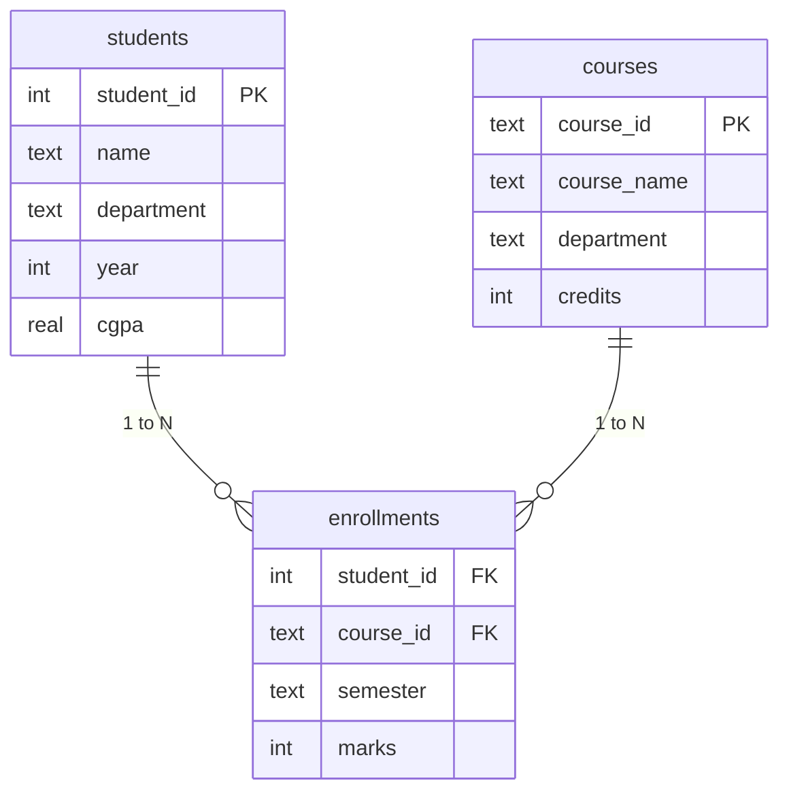

# SDE-SQL: Example Queries Guide
> **Comprehensive list of Natural Language questions you can ask the SDE-SQL system to generate and execute SQL queries.**

This guide lists questions categorized by SQL capability, complexity level, and real-world academic use cases. Use these directly in the **Streamlit UI** or send them via the **`/api/query`** REST endpoint.

---

## 🗄️ Database Schema Quick Reference

The system operates on the `college.db` database with 3 tables (1,000 students, 31 courses, 1,693 enrollments):



---

## 🌟 Top 10 Recommended Showcase Queries (For Live Demos)

These 10 queries demonstrate the entire SDE-SQL pipeline — from simple single-table filters to multi-table JOINs and nested subqueries:

| # | What to Ask in Natural Language | Expected SQL Pattern | Pipeline Highlight |
|---|---|---|---|
| **1** | `Which students are from the CSE department?` | `SELECT name FROM students WHERE department = 'CSE';` | Fast Schema Linking (0ms LLM) |
| **2** | `Show the top 5 students with the highest CGPA.` | `SELECT name, cgpa FROM students ORDER BY cgpa DESC LIMIT 5;` | ORDER BY + LIMIT |
| **3** | `Which students have a CGPA greater than 8.5 in their 4th year?` | `SELECT name, cgpa FROM students WHERE cgpa > 8.5 AND year = 4;` | Stage-B Condition Probe |
| **4** | `How many students are enrolled in each department?` | `SELECT department, COUNT(*) FROM students GROUP BY department;` | Aggregation & GROUP BY |
| **5** | `What is the average CGPA of students in the ECE department?` | `SELECT AVG(cgpa) FROM students WHERE department = 'ECE';` | AVG calculation |
| **6** | `What courses is Alice Smith enrolled in?` | `SELECT c.course_name FROM courses c JOIN enrollments e ON c.course_id = e.course_id JOIN students s ON e.student_id = s.student_id WHERE s.name = 'Alice Smith';` | 3-Table JOIN |
| **7** | `List all students who scored more than 90 marks in any course.` | `SELECT DISTINCT s.name FROM students s JOIN enrollments e ON s.student_id = e.student_id WHERE e.marks > 90;` | DISTINCT + JOIN filter |
| **8** | `Find the student who has the highest CGPA in the college.` | `SELECT name, cgpa FROM students WHERE cgpa = (SELECT MAX(cgpa) FROM students);` | Nested Subquery |
| **9** | `Which departments offer courses with more than 3 credits?` | `SELECT DISTINCT department FROM courses WHERE credits > 3;` | Value Grounding Probe |
| **10**| `Which students have not enrolled in any courses yet?` | `SELECT name FROM students WHERE student_id NOT IN (SELECT student_id FROM enrollments);` | Set Difference (NOT IN) |

---

## 1. Basic Filtering & Column Selection (Projection)

Simple single-table queries that test entity resolution and column mapping.

### Query 1.1
- **Ask:** `Which students are from CSE?`
- **SQL:**
  ```sql
  SELECT name FROM students WHERE department = 'CSE';
  ```

### Query 1.2
- **Ask:** `Give me the names and CGPAs of all students.`
- **SQL:**
  ```sql
  SELECT name, cgpa FROM students;
  ```

### Query 1.3
- **Ask:** `List all courses in the ECE department.`
- **SQL:**
  ```sql
  SELECT course_name FROM courses WHERE department = 'ECE';
  ```

### Query 1.4
- **Ask:** `What are the names of students in their 3rd year?`
- **SQL:**
  ```sql
  SELECT name FROM students WHERE year = 3;
  ```

### Query 1.5
- **Ask:** `Which courses offer 4 credits?`
- **SQL:**
  ```sql
  SELECT course_name FROM courses WHERE credits = 4;
  ```

### Query 1.6
- **Ask:** `Find all students whose CGPA is greater than 9.0.`
- **SQL:**
  ```sql
  SELECT name, department, cgpa FROM students WHERE cgpa > 9.0;
  ```

---

## 2. Statistical Aggregations (COUNT, AVG, MAX, MIN, SUM)

Queries requiring mathematical aggregations over table columns.

### Query 2.1
- **Ask:** `How many total students are in the college?`
- **SQL:**
  ```sql
  SELECT COUNT(*) FROM students;
  ```

### Query 2.2
- **Ask:** `What is the highest CGPA among all students?`
- **SQL:**
  ```sql
  SELECT MAX(cgpa) FROM students;
  ```

### Query 2.3
- **Ask:** `What is the minimum CGPA in the college?`
- **SQL:**
  ```sql
  SELECT MIN(cgpa) FROM students;
  ```

### Query 2.4
- **Ask:** `Find the average CGPA of students in the CSE department.`
- **SQL:**
  ```sql
  SELECT AVG(cgpa) FROM students WHERE department = 'CSE';
  ```

### Query 2.5
- **Ask:** `What is the total number of credits for all courses in the Mechanical department?`
- **SQL:**
  ```sql
  SELECT SUM(credits) FROM courses WHERE department = 'MECH';
  ```

### Query 2.6
- **Ask:** `What is the average marks obtained in the course CS101?`
- **SQL:**
  ```sql
  SELECT AVG(marks) FROM enrollments WHERE course_id = 'CS101';
  ```

---

## 3. Grouping & Conditional Aggregations (GROUP BY & HAVING)

Queries that group data across categories and filter aggregated groups.

### Query 3.1
- **Ask:** `How many students are there in each department?`
- **SQL:**
  ```sql
  SELECT department, COUNT(student_id) FROM students GROUP BY department;
  ```

### Query 3.2
- **Ask:** `How many courses are offered by each department?`
- **SQL:**
  ```sql
  SELECT department, COUNT(course_id) FROM courses GROUP BY department;
  ```

### Query 3.3
- **Ask:** `What is the average CGPA for each year of study?`
- **SQL:**
  ```sql
  SELECT year, AVG(cgpa) FROM students GROUP BY year;
  ```

### Query 3.4
- **Ask:** `Which departments have more than 100 students?`
- **SQL:**
  ```sql
  SELECT department, COUNT(*) FROM students GROUP BY department HAVING COUNT(*) > 100;
  ```

### Query 3.5
- **Ask:** `Which courses have an average score above 80 marks?`
- **SQL:**
  ```sql
  SELECT course_id, AVG(marks) FROM enrollments GROUP BY course_id HAVING AVG(marks) > 80;
  ```

### Query 3.6
- **Ask:** `What is the student count grouped by both department and year?`
- **SQL:**
  ```sql
  SELECT department, year, COUNT(*) FROM students GROUP BY department, year;
  ```

---

## 4. Ordering, Top-K & Limiting (ORDER BY & LIMIT)

Queries that sort and rank records.

### Query 4.1
- **Ask:** `Show me all students ordered by their year of study descending.`
- **SQL:**
  ```sql
  SELECT name, year FROM students ORDER BY year DESC;
  ```

### Query 4.2
- **Ask:** `Who are the top 10 students with the highest CGPA?`
- **SQL:**
  ```sql
  SELECT name, department, cgpa FROM students ORDER BY cgpa DESC LIMIT 10;
  ```

### Query 4.3
- **Ask:** `List the 5 hardest courses based on the lowest average marks.`
- **SQL:**
  ```sql
  SELECT course_id, AVG(marks) as avg_marks FROM enrollments GROUP BY course_id ORDER BY avg_marks ASC LIMIT 5;
  ```

### Query 4.4
- **Ask:** `Show the 3 students with the lowest CGPA in the MECH department.`
- **SQL:**
  ```sql
  SELECT name, cgpa FROM students WHERE department = 'MECH' ORDER BY cgpa ASC LIMIT 3;
  ```

---

## 5. Multi-Table Relational Queries (JOINs)

Queries requiring foreign-key navigation across `students`, `courses`, and `enrollments`.

### Query 5.1
- **Ask:** `What are the names of students and the courses they are enrolled in?`
- **SQL:**
  ```sql
  SELECT s.name, c.course_name 
  FROM students s 
  JOIN enrollments e ON s.student_id = e.student_id 
  JOIN courses c ON e.course_id = c.course_id;
  ```

### Query 5.2
- **Ask:** `Find the names of students who are taking 'Data Structures'.`
- **SQL:**
  ```sql
  SELECT s.name 
  FROM students s 
  JOIN enrollments e ON s.student_id = e.student_id 
  JOIN courses c ON e.course_id = c.course_id 
  WHERE c.course_name = 'Data Structures';
  ```

### Query 5.3
- **Ask:** `List the names of students who scored more than 90 marks in any course.`
- **SQL:**
  ```sql
  SELECT DISTINCT s.name 
  FROM students s 
  JOIN enrollments e ON s.student_id = e.student_id 
  WHERE e.marks > 90;
  ```

### Query 5.4
- **Ask:** `Find the names of students enrolled in the 'Fall2023' semester.`
- **SQL:**
  ```sql
  SELECT DISTINCT s.name 
  FROM students s 
  JOIN enrollments e ON s.student_id = e.student_id 
  WHERE e.semester = 'Fall2023';
  ```

### Query 5.5
- **Ask:** `What is the average marks of Alice Smith across all her courses?`
- **SQL:**
  ```sql
  SELECT AVG(e.marks) 
  FROM enrollments e 
  JOIN students s ON e.student_id = s.student_id 
  WHERE s.name = 'Alice Smith';
  ```

### Query 5.6
- **Ask:** `List all students taking courses offered by a department other than their own.`
- **SQL:**
  ```sql
  SELECT DISTINCT s.name, s.department as student_dept, c.department as course_dept 
  FROM students s 
  JOIN enrollments e ON s.student_id = e.student_id 
  JOIN courses c ON e.course_id = c.course_id 
  WHERE s.department != c.department;
  ```

### Query 5.7
- **Ask:** `How many students are taking a course with 4 credits?`
- **SQL:**
  ```sql
  SELECT COUNT(DISTINCT s.student_id) 
  FROM students s 
  JOIN enrollments e ON s.student_id = e.student_id 
  JOIN courses c ON e.course_id = c.course_id 
  WHERE c.credits = 4;
  ```

---

## 6. Multiple Conditions & Range Queries (AND, OR, BETWEEN, IN)

Queries combining several logical operators and ranges.

### Query 6.1
- **Ask:** `Which students from the CSE department have a CGPA above 8.5 and are in their 4th year?`
- **SQL:**
  ```sql
  SELECT name FROM students WHERE department = 'CSE' AND cgpa > 8.5 AND year = 4;
  ```

### Query 6.2
- **Ask:** `Which students belong to either ECE or EEE department?`
- **SQL:**
  ```sql
  SELECT name, department FROM students WHERE department IN ('ECE', 'EEE');
  ```

### Query 6.3
- **Ask:** `List all students whose CGPA is between 7.5 and 8.5.`
- **SQL:**
  ```sql
  SELECT name, cgpa FROM students WHERE cgpa BETWEEN 7.5 AND 8.5;
  ```

### Query 6.4
- **Ask:** `Show 1st or 2nd year students who have a CGPA above 9.0.`
- **SQL:**
  ```sql
  SELECT name, year, cgpa FROM students WHERE year IN (1, 2) AND cgpa > 9.0;
  ```

---

## 7. Advanced Nested Queries & Subqueries

Complex SQL queries utilizing subqueries, `IN`, `NOT IN`, and scalar sub-selects.

### Query 7.1
- **Ask:** `Find the student who has the highest CGPA in the college.`
- **SQL:**
  ```sql
  SELECT name, cgpa FROM students WHERE cgpa = (SELECT MAX(cgpa) FROM students);
  ```

### Query 7.2
- **Ask:** `Which students have not enrolled in any courses?`
- **SQL:**
  ```sql
  SELECT name FROM students WHERE student_id NOT IN (SELECT student_id FROM enrollments);
  ```

### Query 7.3
- **Ask:** `List all courses that have no enrollments.`
- **SQL:**
  ```sql
  SELECT course_name FROM courses WHERE course_id NOT IN (SELECT course_id FROM enrollments);
  ```

### Query 7.4
- **Ask:** `Which students have a CGPA higher than the average CGPA of their department?`
- **SQL:**
  ```sql
  SELECT s.name, s.department, s.cgpa 
  FROM students s 
  WHERE s.cgpa > (SELECT AVG(cgpa) FROM students WHERE department = s.department);
  ```

### Query 7.5
- **Ask:** `Which course has the highest average marks?`
- **SQL:**
  ```sql
  SELECT c.course_name 
  FROM courses c 
  JOIN enrollments e ON c.course_id = e.course_id 
  GROUP BY c.course_id 
  ORDER BY AVG(e.marks) DESC LIMIT 1;
  ```

### Query 7.6
- **Ask:** `What is the department with the highest total credits offered?`
- **SQL:**
  ```sql
  SELECT department 
  FROM courses 
  GROUP BY department 
  ORDER BY SUM(credits) DESC LIMIT 1;
  ```

---

## 8. Pattern Matching & String Filtering (LIKE)

Queries testing text search and string pattern matching.

### Query 8.1
- **Ask:** `List all courses that have 'Programming' in their name.`
- **SQL:**
  ```sql
  SELECT course_name FROM courses WHERE course_name LIKE '%Programming%';
  ```

### Query 8.2
- **Ask:** `Find all students whose name starts with 'A'.`
- **SQL:**
  ```sql
  SELECT name FROM students WHERE name LIKE 'A%';
  ```

### Query 8.3
- **Ask:** `Which courses are introductory courses starting with 'Intro'?`
- **SQL:**
  ```sql
  SELECT course_name FROM courses WHERE course_name LIKE 'Intro%';
  ```

---

## 9. Real-World Academic & Administration Questions

Realistic questions asked by college administrators, deans, or academic advisors.

### Query 9.1: Dean's Honor Roll
- **Ask:** `Who are the students eligible for Dean's List with CGPA >= 9.0 in year 3 or 4?`
- **SQL:**
  ```sql
  SELECT name, department, year, cgpa FROM students WHERE cgpa >= 9.0 AND year >= 3 ORDER BY cgpa DESC;
  ```

### Query 9.2: Department Performance
- **Ask:** `What is the average, highest, and lowest CGPA for each department?`
- **SQL:**
  ```sql
  SELECT department, AVG(cgpa) as avg_cgpa, MAX(cgpa) as max_cgpa, MIN(cgpa) as min_cgpa FROM students GROUP BY department;
  ```

### Query 9.3: Course Enrollment Load
- **Ask:** `How many students are enrolled in each course?`
- **SQL:**
  ```sql
  SELECT c.course_name, COUNT(e.student_id) as enrolled_count FROM courses c LEFT JOIN enrollments e ON c.course_id = e.course_id GROUP BY c.course_id;
  ```

### Query 9.4: Semester-wise Registration
- **Ask:** `How many course registrations occurred in each semester?`
- **SQL:**
  ```sql
  SELECT semester, COUNT(*) as registrations FROM enrollments GROUP BY semester ORDER BY registrations DESC;
  ```

---

## 💡 Tips for Asking Questions to SDE-SQL

1. **Be specific with column concepts:**
   - Use `"CGPA"` or `"GPA"` for grades.
   - Use `"year"` or `"year of study"` for 1st, 2nd, 3rd, 4th year.
   - Use standard department abbreviations (`CSE`, `ECE`, `MECH`, `EEE`, `CIVIL`, `IT`, `AI-DS`) or full names (`Computer Science`).
2. **Review the Probes generated:**
   - In the Streamlit UI, expand **Exploration Probes** to see the exploratory `SELECT DISTINCT` queries SDE-SQL automatically executed before generating the answer.
3. **Inspect the Refinement History:**
   - If a generated query had a syntax error, expand **Refinement History** to see how the engine caught the error with SQLGlot and self-corrected.
